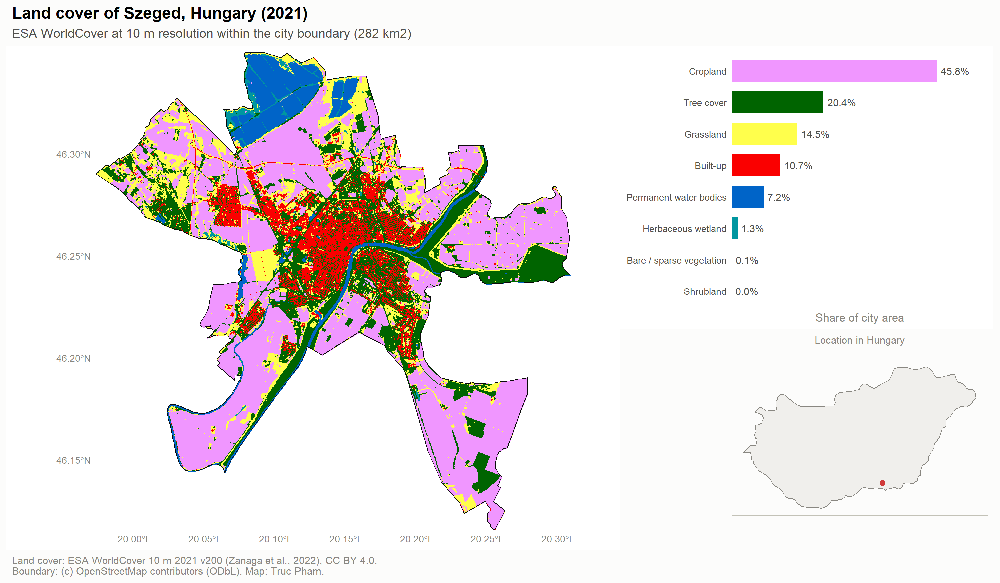

# Land cover of Szeged, Hungary

A 10 m land-cover map and area statistics for the city of Szeged, built in R from the ESA WorldCover 2021 satellite product and the official OpenStreetMap city boundary.



## What it does

1. **Boundary.** Downloads Szeged's administrative boundary from OpenStreetMap (via Nominatim) once and caches it in `data/szeged_boundary.gpkg`.
2. **Land cover.** Reads only the Szeged window of the ESA WorldCover 2021 v200 tile `N45E018` directly from the public AWS bucket, then crops and masks it to the boundary. No 3° tile download is needed.
3. **Area by class.** Sums true pixel areas (`terra::cellSize`) for each land-cover class, so the geographic raster does not need reprojecting.
4. **Outputs.** Writes a clipped GeoTIFF, a CSV of area and share by class, and a map with a class-share chart and a locator map of Hungary.

Classes and colours follow the official WorldCover legend (Product User Manual v2.0).

## How to run

Requires R (≥ 4.1) with `terra`, `sf`, `ggplot2`, `patchwork`, `rnaturalearthdata` and `osmdata`, plus an internet connection for the first run.

```r
install.packages(c("terra", "sf", "ggplot2", "patchwork", "rnaturalearthdata", "osmdata"))
source("R/szeged_land_cover.R")
```

If the remote read fails (for example behind a firewall), download tile `ESA_WorldCover_10m_2021_v200_N45E018_Map.tif` from the [WorldCover viewer](https://worldcover2021.esa.int/download) into `data/raw/`; the script uses the local file automatically.

## Outputs

| File | Content |
| --- | --- |
| `outputs/szeged_land_cover_map.png` | Map, class shares and locator |
| `outputs/szeged_land_cover_by_class.csv` | Area (km²) and share (%) by class |
| `outputs/szeged_worldcover_2021.tif` | WorldCover raster clipped to the city |

## Limitations

- WorldCover is a global product with known classification errors; see the accuracy assessment in the [Product User Manual](https://esa-worldcover.s3.eu-central-1.amazonaws.com/v200/2021/docs/WorldCover_PUM_V2.0.pdf). Small urban green spaces and mixed pixels are less reliable than large uniform areas.
- The administrative boundary includes farmland and floodplain around the urban core, so city-wide shares differ from those of the built-up area alone.

## Data and licences

- Land cover: Zanaga, D., Van De Kerchove, R., Daems, D., et al. (2022). *ESA WorldCover 10 m 2021 v200*. Zenodo. [doi:10.5281/zenodo.7254221](https://doi.org/10.5281/zenodo.7254221). CC BY 4.0.
- Boundary: © OpenStreetMap contributors, ODbL.
- Country outline: Natural Earth (public domain).
- Code: [MIT](LICENSE).

## Author

**Truc Pham** · [truc-pham.github.io](https://truc-pham.github.io) · [ORCID 0009-0004-1892-492X](https://orcid.org/0009-0004-1892-492X)
